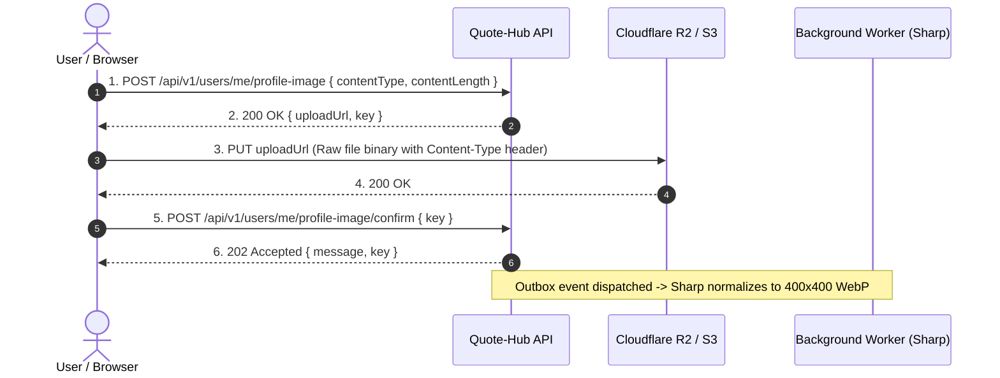

# Quote-Hub REST API Documentation for Frontend Developers

Welcome to the **Quote-Hub** REST API reference. This document is specifically crafted for Frontend Developers building the web, mobile, or desktop clients. It covers authentication, request conventions, error handling, rate limiting, data types, and exhaustive endpoint documentation with full request and response examples.

---

## Table of Contents

1. [Quick Overview & Architecture](#1-quick-overview--architecture)
2. [Base URLs & Environment Setup](#2-base-urls--environment-setup)
3. [Global Request & Response Conventions](#3-global-request--response-conventions)
4. [Error Handling Contract (RFC 9457)](#4-error-handling-contract-rfc-9457)
5. [Rate Limiting & Retry Policies](#5-rate-limiting--retry-policies)
6. [Idempotency Semantics](#6-idempotency-semantics)
7. [Pagination & Cursor Mechanics](#7-pagination--cursor-mechanics)
8. [Authentication & Session Lifecycle (Better Auth)](#8-authentication--session-lifecycle-better-auth)
9. [TypeScript Type Definitions](#9-typescript-type-definitions)
10. [API Endpoints Reference](#10-api-endpoints-reference)
    - [10.1 Health Checks](#101-health-checks)
    - [10.2 Authentication](#102-authentication)
    - [10.3 Themes](#103-themes)
    - [10.4 Users & Profile](#104-users--profile)
    - [10.5 Quotes Management](#105-quotes-management)
    - [10.6 Social Interactions (Likes, Reposts, Bookmarks, Follows)](#106-social-interactions-likes-reposts-bookmarks-follows)
    - [10.7 Feeds, Trending & Discovery](#107-feeds-trending--discovery)
    - [10.8 Notifications](#108-notifications)
    - [10.9 Admin & Moderation](#109-admin--moderation)
11. [Frontend Workflows & Recipes](#11-frontend-workflows--recipes)
    - [Recipe A: The 2-Step Avatar Upload Workflow](#recipe-a-the-2-step-avatar-upload-workflow)
    - [Recipe B: Infinite Scrolling with TanStack Query](#recipe-b-infinite-scrolling-with-tanstack-query)
    - [Recipe C: Optimistic Social Actions (Likes/Reposts/Bookmarks)](#recipe-c-optimistic-social-actions-likesrepostsbookmarks)
    - [Recipe D: Idempotent Form Submissions](#recipe-d-idempotent-form-submissions)

---

## 1. Quick Overview & Architecture

Quote-Hub is a quote-centric social platform backend built as a modular monolith in Node.js, Express, TypeScript, PostgreSQL, and Redis.

### Key Rules to Know as a Frontend Developer:
- **UUIDv7 Identifiers**: All entity primary keys (`id`, `userId`, `quoteId`, etc.) are time-ordered **UUIDv7** strings (e.g. `018f3a2c-1000-7000-8000-000000000001`).
- **Quote Character Limit**: Quotes are strictly limited to **280 Unicode characters**. The API counts Unicode code points (`[...text].length`), accurately counting multi-byte emojis (e.g. 🚀 counts as 1 character, not 2).
- **Attribution Invariant**:
  - If `isOriginal: true`, `authorName` **must be null or omitted**.
  - If `isOriginal: false`, `authorName` is optional (max 100 chars).
- **Self-Interaction Restrictions**: Users **cannot like their own quotes** and **cannot follow themselves**. (Attempting to do so returns HTTP 400 with dedicated error codes). Users **can** repost their own quotes.
- **Soft Deletion**: Deleting quotes or user accounts soft-deletes the records (`deletedAt != null`). The backend automatically filters soft-deleted items from public feeds, search, and profiles.

---

## 2. Base URLs & Environment Setup

| Environment | Base URL | Swagger UI Docs | Notes |
| :--- | :--- | :--- | :--- |
| **Local Development** | `http://localhost:4000` | `http://localhost:4000/docs` | Default development server |
| **Production** | Configured per deployment | `/docs` | Served via HTTPS |

### CORS & Cookies
- The backend configures CORS using `FRONTEND_ORIGIN` (default `http://localhost:3000`).
- **CORS Credentials**: Cross-origin requests **must** include credentials (`credentials: "include"` in `fetch`, or `withCredentials: true` in `axios`).
- **Content-Type**: All mutation requests sending JSON must set `Content-Type: application/json`.

---

## 3. Global Request & Response Conventions

### Request Headers

| Header | Required | Format / Value | Description |
| :--- | :--- | :--- | :--- |
| `Content-Type` | For mutations with body | `application/json` | Required whenever sending a JSON request body |
| `x-request-id` | Optional | `UUIDv7` or string | Client-provided correlation ID. If omitted, the server automatically generates one and echoes it back in the response headers. |
| `Idempotency-Key` | Optional (Recommended on mutations) | Unique string (max 255 chars) | Used to guarantee exactly-once execution for mutations like creating a quote or confirming an avatar. |
| `Authorization` | Optional (if not using cookies) | `Bearer <session_token>` | Alternative to HTTP-only cookie authentication. |

### Response Headers

| Header | Description |
| :--- | :--- |
| `x-request-id` | The unique request correlation ID for tracing in logs and Sentry |
| `Content-Type` | `application/json; charset=utf-8` on success, or `application/problem+json` on errors |
| `X-RateLimit-Limit` | Maximum allowed requests within the current window |
| `X-RateLimit-Remaining` | Remaining request tokens available in the current window |
| `Retry-After` | Present when rate limited (HTTP 429). Seconds to wait before retrying |
| `X-Cache-Idempotent` | Echoed as `HIT` when an idempotent mutation response was replayed from cache |

---

## 4. Error Handling Contract (RFC 9457)

Every non-2xx response returned by the backend strictly follows the **RFC 9457 Problem Details** standard with `Content-Type: application/problem+json`.

### Error Payload Schema

```typescript
interface ProblemDetailsResponse {
  type: string;                    // Problem type URI (default: "about:blank")
  title: string;                   // Short human-readable summary
  status: number;                  // HTTP status code (e.g. 400, 401, 404, 409)
  detail: string;                  // Occurrence-specific explanation
  code: string;                    // Application machine-readable error code
  instance?: string;               // Correlation ID (x-request-id)
  errors?: Record<string, string[]>; // Field-level validation error map
}
```

### Standard Error Codes Catalog

| HTTP Status | Application `code` | Description / Cause |
| :--- | :--- | :--- |
| **400** | `VALIDATION_ERROR` | Schema validation failed. Inspect `errors` map for field errors |
| **400** | `CANNOT_LIKE_OWN_QUOTE` | Attempted to like a quote authored by yourself |
| **400** | `CANNOT_FOLLOW_SELF` | Attempted to follow your own account |
| **401** | `AUTHENTICATION_REQUIRED` | No active session provided or session expired |
| **403** | `AUTHORIZATION_ERROR` | Authenticated, but not permitted to perform the action |
| **403** | `ACCOUNT_SUSPENDED` | User account is currently suspended by an administrator |
| **403** | `ADMIN_ACCESS_REQUIRED` | Route requires `ADMIN` role |
| **403** | `FORBIDDEN` | Attempted to modify or delete a resource owned by another user |
| **404** | `NOT_FOUND` | Target resource does not exist or has been soft-deleted |
| **409** | `CONFLICT` | Resource already exists (e.g. duplicate username) |
| **409** | `IDEMPOTENCY_MISMATCH` | Idempotency key reused with different request payload |
| **409** | `IDEMPOTENCY_KEY_IN_PROGRESS` | Concurrent in-flight request already executing with same key |
| **429** | `RATE_LIMIT_EXCEEDED` | Rate limit threshold reached. Wait for `Retry-After` seconds |
| **500** | `INTERNAL_SERVER_ERROR` | Unhandled server exception. Report `instance` correlation ID |

### Validation Error Example (HTTP 400)

```json
{
  "type": "about:blank",
  "title": "Validation failed",
  "status": 400,
  "detail": "Validation failed",
  "code": "VALIDATION_ERROR",
  "instance": "01925b6a-9321-789a-b456-123456789abc",
  "errors": {
    "text": [
      "Quote text must not exceed 280 characters"
    ],
    "authorName": [
      "Original quotes must not specify an author name"
    ]
  }
}
```

---

## 5. Rate Limiting & Retry Policies

The API uses a token-bucket rate limiter backed by Redis (with fallback to an in-memory bucket). When the token bucket is exhausted, requests receive **HTTP 429 Too Many Requests**.

### Limits by Route Category

| Operation | Route Prefix | Max Requests | Window | Notes |
| :--- | :--- | :--- | :--- | :--- |
| **Auth** | `/api/auth/*`, `/api/v1/auth/*` | **30** | 60 sec | Covers sign-in, sign-up, session refresh |
| **Quote Creation** | `POST /api/v1/quotes` | **30** | 60 sec | Prevents quote spamming |
| **Likes** | `POST/DELETE /api/v1/quotes/:id/like` | **60** | 60 sec | Social interaction burst tolerance |
| **Reposts** | `POST/DELETE /api/v1/quotes/:id/repost` | **30** | 60 sec | Prevents timeline flooding |
| **Follows** | `POST/DELETE /api/v1/users/:id/follow` | **30** | 60 sec | Prevents follow churn |
| **Search** | `GET /api/v1/search` | **60** | 60 sec | Fuzzy trigram search operations |
| **Notifications** | `/api/v1/notifications/*` | **60** | 60 sec | Inbox polling and read updates |
| **Admin** | `/api/v1/admin/*` | **100** | 60 sec | Administrative actions |

### Recommended Frontend Axios / Fetch Interceptor

```typescript
async function fetchWithRetry(url: string, options: RequestInit = {}): Promise<Response> {
  const response = await fetch(url, options);

  if (response.status === 429) {
    const retryAfter = response.headers.get("Retry-After");
    const waitSeconds = retryAfter ? parseInt(retryAfter, 10) : 1;
    await new Promise((resolve) => setTimeout(resolve, waitSeconds * 1000));
    return fetchWithRetry(url, options);
  }

  return response;
}
```

---

## 6. Idempotency Semantics

For sensitive mutations where duplicate execution must be prevented (network timeouts, mobile double-clicks), pass an `Idempotency-Key` header:

- **Supported Endpoints**:
  - `POST /api/v1/quotes`
  - `POST /api/v1/users/me/profile-image/confirm`
- **Header Format**: `Idempotency-Key: <unique-string>` (e.g. UUIDv4, max 255 chars).
- **Scope**: Keys are scoped per `(userId, endpoint, key)`.
- **TTL**: Cached responses are kept for **24 hours**.
- **Behavior**:
  1. **First Request**: Executes mutation normally, returns 201/202, stores SHA-256 payload digest.
  2. **Replayed Request with identical payload**: Returns original response with header `X-Cache-Idempotent: HIT`.
  3. **Replayed Request with altered payload**: Returns HTTP 409 Conflict with `code: "IDEMPOTENCY_MISMATCH"`.
  4. **Concurrent In-Flight Request**: Returns HTTP 409 Conflict with `code: "IDEMPOTENCY_KEY_IN_PROGRESS"`.

---

## 7. Pagination & Cursor Mechanics

Quote-Hub uses **composite keyset cursor pagination** over `(createdAt, id)` to achieve constant-time $O(1)$ query speed regardless of page depth.

### Query Parameters

| Parameter | Type | Default | Constraints | Description |
| :--- | :--- | :--- | :--- | :--- |
| `cursor` | `string` | `undefined` | Base64url encoded string | Opaque cursor token returned from previous page's `nextCursor` |
| `limit` | `number` | `20` | Min 1, Max 50 or 100 depending on endpoint | Number of records to return per page |

### Standard Paginated Envelope

```typescript
interface PaginatedResponse<T> {
  data: T[];
  pagination: {
    nextCursor: string | null; // Pass this back in ?cursor= for the next page
    hasMore: boolean;          // false when on the final page
  };
}
```

> [!NOTE]
> Treat the `cursor` as an opaque token. Never construct or parse cursors client-side in production. Simply pass `pagination.nextCursor` into your next API call.

---

## 8. Authentication & Session Lifecycle (Better Auth)

Quote-Hub's authentication engine is powered by **Better Auth** mounted at both `/api/auth/*` and `/api/v1/auth/*`.

### Session Mechanism
1. On successful `sign-in` or `sign-up`, the server sets an `HttpOnly`, `SameSite=Lax` cookie: `better-auth.session_token`.
2. Browser clients automatically send this cookie with every subsequent request when `credentials: "include"` is set.
3. Native mobile clients or environments unable to use cookies can send:
   `Authorization: Bearer <session_token>`

### Core Auth Endpoints Summary

#### 1. Register User with Email
```http
POST /api/auth/sign-up/email
Content-Type: application/json

{
  "email": "user@example.com",
  "password": "Password123!",
  "name": "Jane Doe"
}
```
**Response (200 OK):**
```json
{
  "token": "session_token_xyz...",
  "user": {
    "id": "auth-user-id",
    "email": "user@example.com",
    "name": "Jane Doe",
    "emailVerified": false
  }
}
```

#### 2. Sign In with Email
```http
POST /api/auth/sign-in/email
Content-Type: application/json

{
  "email": "user@example.com",
  "password": "Password123!"
}
```
**Response (200 OK):**
```json
{
  "token": "session_token_xyz...",
  "user": {
    "id": "auth-user-id",
    "email": "user@example.com",
    "name": "Jane Doe",
    "emailVerified": true
  }
}
```

#### 3. Inspect Active Session
```http
GET /api/auth/get-session
```
**Response (200 OK - Active Session):**
```json
{
  "session": {
    "id": "session-id",
    "userId": "auth-user-id",
    "token": "session_token_xyz...",
    "expiresAt": "2026-11-10T00:00:00.000Z"
  },
  "user": {
    "id": "auth-user-id",
    "email": "user@example.com",
    "name": "Jane Doe"
  }
}
```
**Response (200 OK - Unauthenticated):** `null`

#### 4. Sign Out
```http
POST /api/auth/sign-out
Content-Type: application/json

{}
```
**Response (200 OK):** Clears cookie.

---

## 9. TypeScript Type Definitions

Export this file into your frontend project (e.g. `src/types/api.ts`):

```typescript
// ============================================================================
// ENUMS & PRIMITIVES
// ============================================================================

export type UserRole = "USER" | "ADMIN";
export type UserStatus = "ACTIVE" | "SUSPENDED" | "DELETED";
export type NotificationType = "LIKE" | "REPOST" | "FOLLOW";
export type FeedItemType = "ORIGINAL_QUOTE" | "REPOST";

// ============================================================================
// DOMAIN MODELS
// ============================================================================

export interface UserProfile {
  id: string;                      // UUIDv7
  username: string;                // 3-30 chars, alphanumeric + underscore
  displayName: string;             // 1-50 chars
  bio: string | null;              // Max 160 chars
  profileImageUrl: string | null;  // CDN URL to 400x400 WebP avatar
  role: UserRole;
  status: UserStatus;
  followerCount: number;
  followingCount: number;
  createdAt: string;               // ISO 8601 date string
  updatedAt: string;
}

export interface Theme {
  id: string;                      // UUIDv7
  key: string;                     // e.g. "classic-serif", "modern-sans"
  name: string;                    // Display name: "Classic Serif"
  isActive: boolean;
  createdAt: string;
  updatedAt: string;
}

export interface Quote {
  id: string;                      // UUIDv7
  userId: string;                  // Author UUID
  text: string;                    // 1-280 Unicode characters
  isOriginal: boolean;             // True if user is author
  authorName: string | null;       // Null if isOriginal is true
  themeId: string;                 // Target theme UUID
  likeCount: number;
  repostCount: number;
  createdAt: string;
  updatedAt: string;
  deletedAt: string | null;
  user?: Pick<UserProfile, "id" | "username" | "displayName" | "profileImageUrl">;
  theme?: Theme;
}

export interface FeedActor {
  id: string;
  username: string;
  displayName: string;
  avatarUrl: string | null;
  profileImageUrl?: string | null;
}

export interface FeedAuthor {
  id: string;
  username: string;
  displayName: string;
  avatarUrl: string | null;
  profileImageUrl?: string | null;
}

export interface FeedQuote {
  id: string;
  text: string;
  isOriginal: boolean;
  authorName: string | null;
  likeCount: number;
  repostCount: number;
  createdAt: string;
  themeKey?: string;
  author: FeedAuthor;
}

export interface FeedItem {
  type: FeedItemType;              // "ORIGINAL_QUOTE" | "REPOST"
  actor: FeedActor;                // The user who posted or reposted
  quote: FeedQuote;                // Canonical quote payload
  createdAt: string;               // Event timestamp
}

export interface SearchResult {
  id: string;
  text: string;
  isOriginal: boolean;
  authorName: string | null;
  likeCount: number;
  repostCount: number;
  createdAt: string;
  rankScore: number;               // Trigram similarity rank
  username: string;
  displayName: string;
  themeKey?: string | null;
  author: {
    id: string;
    username: string;
    displayName: string;
    avatarUrl: string | null;
    profileImageUrl: string | null;
  };
}

export interface NotificationItem {
  id: string;
  userId: string;
  actorId: string;
  type: NotificationType;          // "LIKE" | "REPOST" | "FOLLOW"
  entityId: string;                // quoteId or userId
  readAt: string | null;           // null if unread
  createdAt: string;
  actor: {
    id: string;
    username: string;
    displayName: string;
    profileImageUrl: string | null;
  };
}

export interface DailyMetric {
  metricDate: string;              // "YYYY-MM-DD"
  registeredUsers: number;
  activeUsers: number;
  quotesCreated: number;
  likesCreated: number;
  repostsCreated: number;
  bookmarksCreated: number;
  followsCreated: number;
  createdAt: string;
  updatedAt: string;
}

export interface AuditLog {
  id: string;
  actorUserId: string;
  action: string;
  resourceType: string;
  resourceId: string;
  metadata: Record<string, unknown> | null;
  createdAt: string;
  actorUser: {
    id: string;
    username: string;
    displayName: string;
  };
}

// ============================================================================
// API RESPONSES & ENVELOPES
// ============================================================================

export interface PaginationMeta {
  nextCursor: string | null;
  hasMore: boolean;
}

export interface PaginatedList<T> {
  data: T[];
  pagination: PaginationMeta;
}

export interface FeedResponse {
  data: FeedItem[];
  pagination: PaginationMeta;
}

export interface PresignedUploadResponse {
  uploadUrl: string;               // Direct PUT URL to Cloudflare R2 / S3
  key: string;                     // Temporary object key to confirm
}

export interface SocialActionResponse {
  liked?: boolean;
  reposted?: boolean;
  bookmarked?: boolean;
  following?: boolean;
  quoteId?: string;
  userId?: string;
}
```

---

## 10. API Endpoints Reference

### 10.1 Health Checks

#### `GET /health/live`
- **Auth**: None (Public)
- **Description**: Process liveness probe for container/orchestrator monitoring.
- **Response `200 OK`**:
```json
{
  "status": "alive",
  "timestamp": "2026-10-10T12:00:00.000Z"
}
```

#### `GET /health/ready`
- **Auth**: None (Public)
- **Description**: Dependency readiness probe. Tests the PostgreSQL connection pool.
- **Response `200 OK` (Healthy)**:
```json
{
  "status": "ready",
  "timestamp": "2026-10-10T12:00:00.000Z",
  "services": {
    "database": "healthy"
  }
}
```
- **Response `503 Service Unavailable` (Degraded)**:
```json
{
  "status": "degraded",
  "timestamp": "2026-10-10T12:00:00.000Z",
  "services": {
    "database": "unhealthy"
  }
}
```

---

### 10.2 Authentication

Mounted at `/api/auth/*` and `/api/v1/auth/*`. See [Section 8](#8-authentication--session-lifecycle-better-auth) for full lifecycle overview.

---

### 10.3 Themes

Visual quote cards render with registered themes defining typography and visual layout.

#### `GET /api/v1/themes`
- **Auth**: None (Public)
- **Description**: Retrieves all active themes available for quote styling.
- **Response `200 OK`**:
```json
[
  {
    "id": "018f3a2c-0000-7000-8000-000000000001",
    "key": "classic-serif",
    "name": "Classic Serif",
    "isActive": true,
    "createdAt": "2026-01-01T00:00:00.000Z",
    "updatedAt": "2026-01-01T00:00:00.000Z"
  },
  {
    "id": "018f3a2c-0000-7000-8000-000000000002",
    "key": "modern-sans",
    "name": "Modern Sans",
    "isActive": true,
    "createdAt": "2026-01-01T00:00:00.000Z",
    "updatedAt": "2026-01-01T00:00:00.000Z"
  }
]
```

---

### 10.4 Users & Profile

#### `GET /api/v1/users/:username`
- **Auth**: None (Public)
- **Path Parameters**:
  - `username` (`string`): The user's public handle (e.g. `alice`).
- **Description**: Returns public profile info. Excludes soft-deleted users.
- **Response `200 OK`**:
```json
{
  "id": "018f3a2c-1000-7000-8000-000000000002",
  "username": "alice",
  "displayName": "Alice Smith",
  "bio": "Philosopher, reader, and thinker",
  "profileImageUrl": "https://media.quote-hub.local/avatars/alice.webp",
  "role": "USER",
  "status": "ACTIVE",
  "followerCount": 142,
  "followingCount": 58,
  "createdAt": "2026-01-01T00:00:00.000Z",
  "updatedAt": "2026-01-01T00:00:00.000Z"
}
```
- **Errors**: `404 NOT_FOUND` if username doesn't exist or was soft-deleted.

#### `PATCH /api/v1/users/me`
- **Auth**: Required (`requireAuth`)
- **Description**: Updates profile presentation fields for current user.
- **Request Body**:
```json
{
  "displayName": "Alice S.",
  "bio": "Updated bio text here"
}
```
  - `displayName`: Optional `string`, trimmed, 1 to 50 characters.
  - `bio`: Optional `string | null`, maximum 160 characters.
  - Strict: Disallows modifying `role`, `status`, `id`, `followerCount`, etc.
- **Response `200 OK`**: Returns updated `UserProfile`.

#### `POST /api/v1/users/me/profile-image`
- **Auth**: Required (`requireAuth`)
- **Description**: Generates a presigned Cloudflare R2 / S3 upload URL for direct avatar upload.
- **Request Body**:
```json
{
  "contentType": "image/png",
  "contentLength": 1048576
}
```
  - `contentType` (Required): `"image/jpeg" | "image/png" | "image/webp"`
  - `contentLength` (Optional): Positive integer $\le 5,242,880$ (5 MB)
- **Response `200 OK`**:
```json
{
  "uploadUrl": "https://quotehub-avatars.r2.cloudflarestorage.com/uploads/avatars/018f3a2c-1000-7000-8000-000000000002/1712000000.png?X-Amz-...",
  "key": "uploads/avatars/018f3a2c-1000-7000-8000-000000000002/1712000000.png"
}
```
  - `uploadUrl` expires in 300 seconds (5 minutes).

#### `POST /api/v1/users/me/profile-image/confirm`
- **Auth**: Required (`requireAuth`)
- **Headers**: Supports optional `Idempotency-Key`
- **Description**: Confirms the upload and queues background Sharp worker to resize to 400x400 WebP.
- **Request Body**:
```json
{
  "key": "uploads/avatars/018f3a2c-1000-7000-8000-000000000002/1712000000.png"
}
```
- **Response `202 Accepted`**:
```json
{
  "message": "Avatar upload confirmed, processing queued",
  "key": "uploads/avatars/018f3a2c-1000-7000-8000-000000000002/1712000000.png"
}
```
- **Errors**: `400 VALIDATION_ERROR` if the key format is invalid or belongs to another user.

#### `DELETE /api/v1/users/me`
- **Auth**: Required (`requireAuth`)
- **Description**: Soft-deletes authenticated user's account and stages outbox cleanup.
- **Response `200 OK`**:
```json
{
  "message": "Account deleted successfully"
}
```

---

### 10.5 Quotes Management

#### `GET /api/v1/quotes`
- **Auth**: None (Public)
- **Query Parameters**:
  - `cursor` (Optional `string`): Base64url pagination cursor
  - `limit` (Optional `number`): 1 to 100 (Default: 20)
  - `userId` (Optional `UUID`): Filter quotes created by specific user ID
  - `themeId` (Optional `UUID`): Filter quotes styled with specific theme ID
- **Description**: Lists active quotes ordered reverse-chronologically with keyset cursor pagination.
- **Response `200 OK`**:
```json
{
  "data": [
    {
      "id": "018f3a2c-2000-7000-8000-000000000001",
      "userId": "018f3a2c-1000-7000-8000-000000000002",
      "text": "The unexamined life is not worth living.",
      "isOriginal": false,
      "authorName": "Socrates",
      "themeId": "018f3a2c-0000-7000-8000-000000000001",
      "likeCount": 12,
      "repostCount": 4,
      "createdAt": "2026-03-01T10:00:00.000Z",
      "updatedAt": "2026-03-01T10:00:00.000Z",
      "deletedAt": null,
      "user": {
        "id": "018f3a2c-1000-7000-8000-000000000002",
        "username": "alice",
        "displayName": "Alice Smith",
        "profileImageUrl": "https://media.quote-hub.local/avatars/alice.webp"
      },
      "theme": {
        "id": "018f3a2c-0000-7000-8000-000000000001",
        "key": "classic-serif",
        "name": "Classic Serif",
        "isActive": true,
        "createdAt": "2026-01-01T00:00:00.000Z",
        "updatedAt": "2026-01-01T00:00:00.000Z"
      }
    }
  ],
  "pagination": {
    "nextCursor": "eyJ0IjoiMjAyNi0wMy0wMVQxMDowMDowMC4wMDBaIiwiaSI6IjAxOGYzYTJjLTIwMDAtNzAwMC04MDAwLTAwMDAwMDAwMDAwMSJ9",
    "hasMore": true
  }
}
```

#### `POST /api/v1/quotes`
- **Auth**: Required (`requireAuth`)
- **Rate Limit**: 30 requests / 60 seconds
- **Headers**: Accepts `Idempotency-Key` (Recommended)
- **Description**: Creates a new quote.
- **Request Body**:
```json
{
  "text": "Simplicity is prerequisite for reliability.",
  "isOriginal": false,
  "authorName": "Edsger W. Dijkstra",
  "themeId": "018f3a2c-0000-7000-8000-000000000001"
}
```
  - `text` (Required): 1 to 280 Unicode characters (emojis count as 1 character).
  - `isOriginal` (Required `boolean`): True if written by posting user.
  - `authorName` (Optional `string | null`): Max 100 characters. **Must be null or omitted if `isOriginal` is true**.
  - `themeId` (Required `UUID`): Must reference an active theme.
- **Response `201 Created`**: Returns created `Quote` object.
- **Errors**:
  - `400 VALIDATION_ERROR` (Quote length > 280, or authorName supplied on original quote)
  - `404 NOT_FOUND` (Theme ID does not exist)

#### `GET /api/v1/quotes/:quoteId`
- **Auth**: None (Public)
- **Description**: Retrieves single quote details by UUID.
- **Response `200 OK`**: Returns `Quote` object.
- **Errors**: `404 NOT_FOUND` if quote does not exist or was soft-deleted.

#### `PATCH /api/v1/quotes/:quoteId`
- **Auth**: Required (`requireAuth` - Owner only)
- **Description**: Updates an existing quote's text and/or theme. Only the author can update their quote.
- **Request Body**:
```json
{
  "text": "Refined quote text here.",
  "themeId": "018f3a2c-0000-7000-8000-000000000002"
}
```
  - At least one of `text` or `themeId` must be supplied.
  - `isOriginal` and `authorName` cannot be modified.
- **Response `200 OK`**: Returns updated `Quote` object.
- **Errors**:
  - `403 FORBIDDEN` if caller does not own the quote
  - `404 NOT_FOUND` if quote does not exist

#### `DELETE /api/v1/quotes/:quoteId`
- **Auth**: Required (`requireAuth` - Owner only)
- **Description**: Soft-deletes the quote (`deletedAt = now()`) and evicts it from the Redis trending cache.
- **Response `204 No Content`**: Empty response body.
- **Errors**:
  - `403 FORBIDDEN` if caller does not own the quote
  - `404 NOT_FOUND` if quote does not exist

---

### 10.6 Social Interactions (Likes, Reposts, Bookmarks, Follows)

#### Likes

##### `POST /api/v1/quotes/:quoteId/like`
- **Auth**: Required (`requireAuth`)
- **Rate Limit**: 60 requests / 60 seconds
- **Description**: Likes a quote. Increments `likeCount`, emits outbox notification event. Idempotent: repeated calls safely return without double-counting.
- **Invariants**: Users cannot like their own quotes.
- **Response `200 OK`**:
```json
{
  "liked": true,
  "quoteId": "018f3a2c-2000-7000-8000-000000000001"
}
```
- **Errors**: `400 CANNOT_LIKE_OWN_QUOTE` if liking your own quote.

##### `DELETE /api/v1/quotes/:quoteId/like`
- **Auth**: Required (`requireAuth`)
- **Description**: Unlikes a quote. Atomically decrements `likeCount` (`GREATEST(count - 1, 0)`). Idempotent.
- **Response `200 OK`**:
```json
{
  "liked": false,
  "quoteId": "018f3a2c-2000-7000-8000-000000000001"
}
```

---

#### Reposts

##### `POST /api/v1/quotes/:quoteId/repost`
- **Auth**: Required (`requireAuth`)
- **Rate Limit**: 30 requests / 60 seconds
- **Description**: Reposts a quote to appear in followers' activity feeds. Increments `repostCount`. Idempotent. Users can repost their own quotes.
- **Response `200 OK`**:
```json
{
  "reposted": true,
  "quoteId": "018f3a2c-2000-7000-8000-000000000001"
}
```

##### `DELETE /api/v1/quotes/:quoteId/repost`
- **Auth**: Required (`requireAuth`)
- **Description**: Removes repost. Atomically decrements `repostCount`. Idempotent.
- **Response `200 OK`**:
```json
{
  "reposted": false,
  "quoteId": "018f3a2c-2000-7000-8000-000000000001"
}
```

---

#### Bookmarks

Bookmarks are strictly private to each user and do not affect public quote counts.

##### `POST /api/v1/quotes/:quoteId/bookmark`
- **Auth**: Required (`requireAuth`)
- **Description**: Adds quote to current user's private bookmarks collection. Idempotent.
- **Response `200 OK`**:
```json
{
  "bookmarked": true,
  "quoteId": "018f3a2c-2000-7000-8000-000000000001"
}
```

##### `DELETE /api/v1/quotes/:quoteId/bookmark`
- **Auth**: Required (`requireAuth`)
- **Description**: Removes quote from private bookmarks collection. Idempotent.
- **Response `200 OK`**:
```json
{
  "bookmarked": false,
  "quoteId": "018f3a2c-2000-7000-8000-000000000001"
}
```

##### `GET /api/v1/users/me/bookmarks`
- **Auth**: Required (`requireAuth`)
- **Query Parameters**:
  - `cursor` (Optional `string`): Quote ID cursor
  - `limit` (Optional `number`): 1 to 100 (Default: 20)
- **Description**: Lists bookmarked quotes for current user with cursor pagination. Filters out any quotes that have since been soft-deleted.
- **Response `200 OK`**:
```json
{
  "data": [
    {
      "userId": "018f3a2c-1000-7000-8000-000000000002",
      "quoteId": "018f3a2c-2000-7000-8000-000000000001",
      "createdAt": "2026-03-01T12:00:00.000Z",
      "quote": {
        "id": "018f3a2c-2000-7000-8000-000000000001",
        "text": "The unexamined life is not worth living.",
        "isOriginal": false,
        "authorName": "Socrates",
        "theme": { ... },
        "user": { ... }
      }
    }
  ],
  "items": [ ... ],
  "nextCursor": "018f3a2c-2000-7000-8000-000000000001"
}
```

---

#### Follows

##### `POST /api/v1/users/:userId/follow`
- **Auth**: Required (`requireAuth`)
- **Rate Limit**: 30 requests / 60 seconds
- **Path Parameters**:
  - `userId` (`UUID`): User to follow
- **Description**: Follows user. Increments caller's `followingCount` and target's `followerCount`. Idempotent.
- **Invariants**: Users cannot follow themselves (`CANNOT_FOLLOW_SELF`).
- **Response `200 OK`**:
```json
{
  "following": true,
  "userId": "018f3a2c-1000-7000-8000-000000000003"
}
```
- **Errors**: `400 CANNOT_FOLLOW_SELF` if attempting to follow yourself.

##### `DELETE /api/v1/users/:userId/follow`
- **Auth**: Required (`requireAuth`)
- **Path Parameters**:
  - `userId` (`UUID`): User to unfollow
- **Description**: Unfollows user. Safely decrements non-negative counters. Idempotent.
- **Response `200 OK`**:
```json
{
  "following": false,
  "userId": "018f3a2c-1000-7000-8000-000000000003"
}
```

##### `GET /api/v1/users/:userId/followers`
- **Auth**: None (Public)
- **Query Parameters**: `cursor` (`UUID`), `limit` (`number`, default: 20)
- **Description**: Lists accounts following the target user. Excludes soft-deleted followers.
- **Response `200 OK`**:
```json
{
  "data": [
    {
      "followerId": "018f3a2c-1000-7000-8000-000000000003",
      "followingId": "018f3a2c-1000-7000-8000-000000000002",
      "createdAt": "2026-03-01T12:00:00.000Z",
      "user": {
        "id": "018f3a2c-1000-7000-8000-000000000003",
        "username": "bob",
        "displayName": "Bob Jones",
        "profileImageUrl": null,
        "followerCount": 20,
        "followingCount": 15
      }
    }
  ],
  "items": [ ... ],
  "nextCursor": "018f3a2c-1000-7000-8000-000000000003"
}
```

##### `GET /api/v1/users/:userId/following`
- **Auth**: None (Public)
- **Query Parameters**: `cursor` (`UUID`), `limit` (`number`, default: 20)
- **Description**: Lists accounts that target user follows.
- **Response `200 OK`**: Same envelope as followers list with `user` containing followed account profile.

---

### 10.7 Feeds, Trending & Discovery

#### `GET /api/v1/feed/following`
- **Auth**: Required (`requireAuth`)
- **Query Parameters**:
  - `cursor` (Optional `string`): Base64url cursor
  - `limit` (Optional `number`): 1 to 50 (Default: 20)
- **Description**: Reverse-chronological activity feed of original quotes and reposts created by accounts the authenticated user follows.
- **Response `200 OK`**:
```json
{
  "data": [
    {
      "type": "REPOST",
      "actor": {
        "id": "018f3a2c-1000-7000-8000-000000000003",
        "username": "bob",
        "displayName": "Bob Jones",
        "avatarUrl": null,
        "profileImageUrl": null
      },
      "quote": {
        "id": "018f3a2c-2000-7000-8000-000000000001",
        "text": "The unexamined life is not worth living.",
        "isOriginal": false,
        "authorName": "Socrates",
        "likeCount": 12,
        "repostCount": 4,
        "createdAt": "2026-03-01T10:00:00.000Z",
        "themeKey": "classic-serif",
        "author": {
          "id": "018f3a2c-1000-7000-8000-000000000002",
          "username": "alice",
          "displayName": "Alice Smith",
          "avatarUrl": "https://media.quote-hub.local/avatars/alice.webp",
          "profileImageUrl": "https://media.quote-hub.local/avatars/alice.webp"
        }
      },
      "createdAt": "2026-03-01T15:30:00.000Z"
    }
  ],
  "pagination": {
    "nextCursor": "eyJ0IjoiMjAyNi0wMy0wMVQxNTozMDowMC4wMDBaIiwiaSI6IjAxOGYzYTJjLTIwMDAtNzAwMC04MDAwLTAwMDAwMDAwMDAwMSJ9",
    "hasMore": true
  }
}
```

#### `GET /api/v1/feed/for-you`
- **Auth**: Optional (`optionalAuth` - works for both logged in and guest users)
- **Query Parameters**:
  - `cursor` (Optional `string`): Base64url cursor
  - `limit` (Optional `number`): 1 to 50 (Default: 20)
- **Description**: Algorithmic discovery feed. Initial page blends Redis trending quotes with database backfill; subsequent pages paginate reverse-chronologically.
- **Response `200 OK`**: Same envelope as Following feed (`{ data: FeedItem[], pagination: { nextCursor, hasMore } }`).

#### `GET /api/v1/trending`
- **Auth**: None (Public)
- **Query Parameters**:
  - `limit` (Optional `number`): 1 to 50 (Default: 20)
- **Description**: Fast Redis-accelerated list of top-performing quotes in the past 24 hours ranked by velocity decay:
  $$\text{Score} = \text{Likes} \times 1.0 + \text{Reposts} \times 2.0 + \max(0, 24 - \text{AgeInHours})$$
  Automatically falls back to PostgreSQL if Redis is unavailable.
- **Response `200 OK`**:
```json
{
  "data": [
    {
      "id": "018f3a2c-2000-7000-8000-000000000001",
      "userId": "018f3a2c-1000-7000-8000-000000000002",
      "text": "The unexamined life is not worth living.",
      "isOriginal": false,
      "authorName": "Socrates",
      "themeId": "018f3a2c-0000-7000-8000-000000000001",
      "likeCount": 142,
      "repostCount": 38,
      "createdAt": "2026-03-01T10:00:00.000Z",
      "updatedAt": "2026-03-01T10:00:00.000Z",
      "deletedAt": null
    }
  ]
}
```

#### `GET /api/v1/search`
- **Auth**: None (Public)
- **Rate Limit**: 60 requests / 60 seconds
- **Query Parameters**:
  - `q` (Required `string`): Search query string (max 280 chars)
  - `limit` (Optional `number`): 1 to 50 (Default: 20)
- **Description**: High-speed PostgreSQL `pg_trgm` fuzzy similarity search matching across quote text, author attributions, and user handles.
- **Response `200 OK`**:
```json
{
  "data": [
    {
      "id": "018f3a2c-2000-7000-8000-000000000001",
      "text": "The unexamined life is not worth living.",
      "isOriginal": false,
      "authorName": "Socrates",
      "likeCount": 142,
      "repostCount": 38,
      "createdAt": "2026-03-01T10:00:00.000Z",
      "rankScore": 0.85,
      "username": "alice",
      "displayName": "Alice Smith",
      "themeKey": "classic-serif",
      "author": {
        "id": "018f3a2c-1000-7000-8000-000000000002",
        "username": "alice",
        "displayName": "Alice Smith",
        "avatarUrl": "https://media.quote-hub.local/avatars/alice.webp",
        "profileImageUrl": "https://media.quote-hub.local/avatars/alice.webp"
      }
    }
  ]
}
```

---

### 10.8 Notifications

#### `GET /api/v1/notifications`
- **Auth**: Required (`requireAuth`)
- **Rate Limit**: 60 requests / 60 seconds
- **Query Parameters**:
  - `limit` (Optional `number`): 1 to 100 (Default: 20)
- **Description**: Lists in-app activity notifications for the authenticated user (e.g. when someone likes or reposts their quote, or follows them).
- **Response `200 OK`**:
```json
{
  "data": [
    {
      "id": "018f3a2c-5000-7000-8000-000000000001",
      "userId": "018f3a2c-1000-7000-8000-000000000002",
      "actorId": "018f3a2c-1000-7000-8000-000000000003",
      "type": "LIKE",
      "entityId": "018f3a2c-2000-7000-8000-000000000001",
      "readAt": null,
      "createdAt": "2026-03-01T14:00:00.000Z",
      "actor": {
        "id": "018f3a2c-1000-7000-8000-000000000003",
        "username": "bob",
        "displayName": "Bob Jones",
        "profileImageUrl": null
      }
    }
  ]
}
```

#### `PATCH /api/v1/notifications/read-all`
- **Auth**: Required (`requireAuth`)
- **Description**: Marks all unread notifications as read (`readAt = now()`) for the current user.
- **Response `200 OK`**:
```json
{
  "count": 5
}
```

#### `PATCH /api/v1/notifications/:id/read`
- **Auth**: Required (`requireAuth`)
- **Description**: Marks a specific notification as read. Idempotent.
- **Response `200 OK`**: Returns updated `NotificationItem` with `readAt` set.

---

### 10.9 Admin & Moderation

All endpoints in `/api/v1/admin/*` require an active session where `role === "ADMIN"` and `status === "ACTIVE"`. (Rate limit: 100 req / 60s).

#### `GET /api/v1/admin/users`
- **Query Parameters**:
  - `status` (Optional): `"ACTIVE" | "SUSPENDED" | "DELETED"`
  - `search` (Optional `string`): Filter by username or displayName
  - `limit` (Optional `number`, default 50, max 100)
  - `offset` (Optional `number`, default 0)
- **Response `200 OK`**:
```json
{
  "users": [ ... ],
  "total": 42
}
```

#### `GET /api/v1/admin/users/:userId`
- **Description**: Returns complete user details including suspension reason and timestamps.
- **Response `200 OK`**: Returns `User` entity.

#### `PATCH /api/v1/admin/users/:userId/status`
- **Description**: Suspends, reinstates, or deactivates a user account. Automatically creates an immutable audit log entry.
- **Request Body**:
```json
{
  "status": "SUSPENDED",
  "reason": "Repeated spam violations",
  "until": "2026-11-01T00:00:00.000Z"
}
```
  - `status`: `"ACTIVE" | "SUSPENDED" | "DELETED"`
  - `reason`: Required when status is `SUSPENDED`
  - `until`: Optional date for temporary suspension
- **Response `200 OK`**: Returns updated `User` record.

#### `GET /api/v1/admin/quotes`
- **Query Parameters**: `userId`, `themeId`, `search`, `includeDeleted` (`true|false`), `limit`, `offset`
- **Response `200 OK`**:
```json
{
  "quotes": [ ... ],
  "total": 120
}
```

#### `DELETE /api/v1/admin/quotes/:quoteId`
- **Description**: Administrative quote takedown. Soft-deletes quote and logs audit trail.
- **Request Body**:
```json
{
  "reason": "Terms of Service violation"
}
```
- **Response `204 No Content`**

#### `GET /api/v1/admin/analytics`
- **Query Parameters**: `startDate` (ISO), `endDate` (ISO), `limit` (default 30), `offset`
- **Response `200 OK`**:
```json
{
  "metrics": [
    {
      "metricDate": "2026-03-01T00:00:00.000Z",
      "registeredUsers": 1250,
      "activeUsers": 480,
      "quotesCreated": 72,
      "likesCreated": 512,
      "repostsCreated": 88,
      "bookmarksCreated": 140,
      "followsCreated": 95
    }
  ],
  "total": 30
}
```

#### `GET /api/v1/admin/audit-logs`
- **Query Parameters**: `actorId`, `resourceType`, `resourceId`, `limit`, `offset`
- **Response `200 OK`**:
```json
{
  "logs": [
    {
      "id": "018f3a2c-6000-7000-8000-000000000001",
      "actorUserId": "018f3a2c-1000-7000-8000-000000000001",
      "action": "ADMIN_SUSPENDED_USER",
      "resourceType": "USER",
      "resourceId": "018f3a2c-1000-7000-8000-000000000005",
      "metadata": { "reason": "Spamming inappropriate quotes" },
      "createdAt": "2026-03-01T16:00:00.000Z",
      "actorUser": {
        "id": "018f3a2c-1000-7000-8000-000000000001",
        "username": "admin",
        "displayName": "Admin User"
      }
    }
  ],
  "total": 1
}
```

#### `POST /api/v1/admin/reconcile-counters`
- **Description**: Triggers PostgreSQL maintenance procedure `reconcile_all_counters()` to synchronize any drifted social counter numbers.
- **Response `200 OK`**:
```json
{
  "success": true,
  "message": "Counters reconciled successfully"
}
```

---

## 11. Frontend Workflows & Recipes

### Recipe A: The 2-Step Avatar Upload Workflow

To avoid passing massive image binaries through the Node.js API server, avatars use direct client-to-storage presigned uploads:



#### Client Implementation Function

```typescript
export async function uploadUserAvatar(file: File): Promise<void> {
  // 1. Request presigned upload URL
  const presignRes = await fetch("/api/v1/users/me/profile-image", {
    method: "POST",
    headers: { "Content-Type": "application/json" },
    credentials: "include",
    body: JSON.stringify({
      contentType: file.type,
      contentLength: file.size,
    }),
  });

  if (!presignRes.ok) {
    throw new Error("Failed to get avatar upload URL");
  }

  const { uploadUrl, key } = await presignRes.json();

  // 2. Direct PUT binary upload to Cloudflare R2 / S3
  const uploadRes = await fetch(uploadUrl, {
    method: "PUT",
    headers: {
      "Content-Type": file.type,
    },
    body: file,
  });

  if (!uploadRes.ok) {
    throw new Error("Direct storage upload failed");
  }

  // 3. Confirm upload with API to start Sharp processing
  const confirmRes = await fetch("/api/v1/users/me/profile-image/confirm", {
    method: "POST",
    headers: {
      "Content-Type": "application/json",
      "Idempotency-Key": crypto.randomUUID(),
    },
    credentials: "include",
    body: JSON.stringify({ key }),
  });

  if (!confirmRes.ok) {
    throw new Error("Failed to confirm avatar upload");
  }
}
```

---

### Recipe B: Infinite Scrolling with TanStack Query

```typescript
import { useInfiniteQuery } from "@tanstack/react-query";
import { FeedResponse } from "./types/api";

export function useFollowingFeed() {
  return useInfiniteQuery<FeedResponse>({
    queryKey: ["feed", "following"],
    queryFn: async ({ pageParam }) => {
      const url = new URL("/api/v1/feed/following", window.location.origin);
      url.searchParams.set("limit", "20");
      if (pageParam) {
        url.searchParams.set("cursor", pageParam as string);
      }

      const res = await fetch(url.toString(), { credentials: "include" });
      if (!res.ok) throw new Error("Failed to fetch feed");
      return res.json();
    },
    initialPageParam: null as string | null,
    getNextPageParam: (lastPage) =>
      lastPage.pagination.hasMore ? lastPage.pagination.nextCursor : undefined,
  });
}
```

---

### Recipe C: Optimistic Social Actions (Likes/Reposts/Bookmarks)

Use TanStack Query optimistic mutations to update the UI instantly:

```typescript
import { useMutation, useQueryClient } from "@tanstack/react-query";

export function useLikeQuoteMutation(quoteId: string) {
  const queryClient = useQueryClient();

  return useMutation({
    mutationFn: async ({ currentlyLiked }: { currentlyLiked: boolean }) => {
      const method = currentlyLiked ? "DELETE" : "POST";
      const res = await fetch(`/api/v1/quotes/${quoteId}/like`, {
        method,
        credentials: "include",
      });
      if (!res.ok) throw new Error("Like toggle failed");
      return res.json();
    },
    onMutate: async ({ currentlyLiked }) => {
      // Cancel outgoing refetches so they don't overwrite optimistic update
      await queryClient.cancelQueries({ queryKey: ["quote", quoteId] });

      const previousQuote = queryClient.getQueryData(["quote", quoteId]);

      // Optimistically adjust like count
      queryClient.setQueryData(["quote", quoteId], (old: any) => {
        if (!old) return old;
        return {
          ...old,
          isLiked: !currentlyLiked,
          likeCount: currentlyLiked ? Math.max(0, old.likeCount - 1) : old.likeCount + 1,
        };
      });

      return { previousQuote };
    },
    onError: (_err, _variables, context) => {
      // Rollback on network or authorization error
      if (context?.previousQuote) {
        queryClient.setQueryData(["quote", quoteId], context.previousQuote);
      }
    },
    onSettled: () => {
      queryClient.invalidateQueries({ queryKey: ["quote", quoteId] });
    },
  });
}
```

---

### Recipe D: Idempotent Form Submissions

```typescript
export async function createQuote(data: {
  text: string;
  isOriginal: boolean;
  authorName?: string | null;
  themeId: string;
}) {
  // Generate a client-side UUIDv4 for this specific submit action
  const idempotencyKey = crypto.randomUUID();

  const response = await fetch("/api/v1/quotes", {
    method: "POST",
    headers: {
      "Content-Type": "application/json",
      "Idempotency-Key": idempotencyKey,
    },
    credentials: "include",
    body: JSON.stringify(data),
  });

  if (!response.ok) {
    const error = await response.json();
    throw error;
  }

  return response.json();
}
```
